<p align="center">
  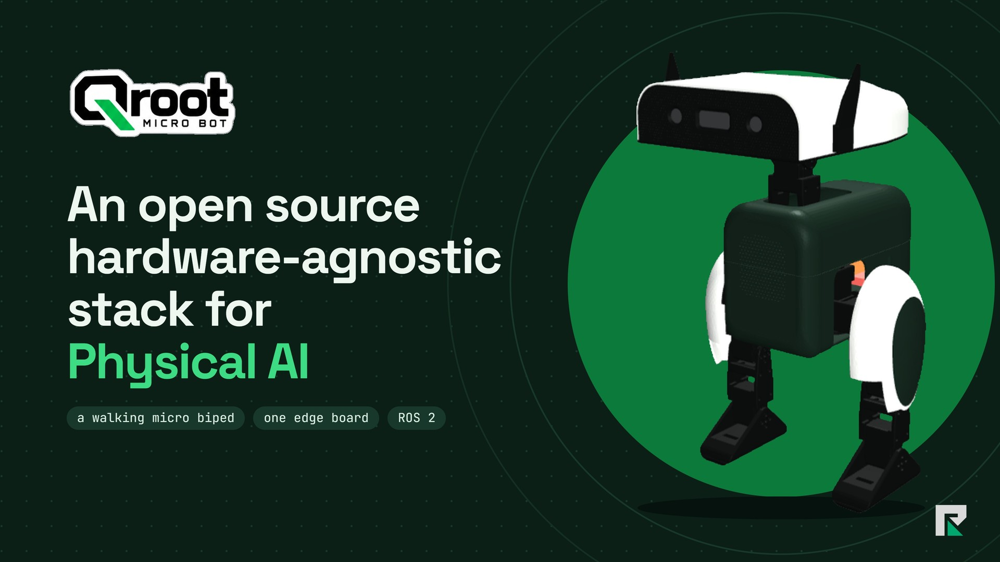
</p>

# Qroot: an open source, hardware-agnostic stack for Physical AI

A walking micro biped, one edge board, ROS 2 at the edges.

Qroot is a full physical AI stack you can read, run and change: training, deployment, compute, actuation,
perception and the body. Every model runs on the robot, with no PC or cloud in the loop. Each layer has one job
and one interface, so you can swap the camera, the chip or the whole body and keep the rest.

<p align="center">
  <a href="docs/media/qroot_walk.mp4">
    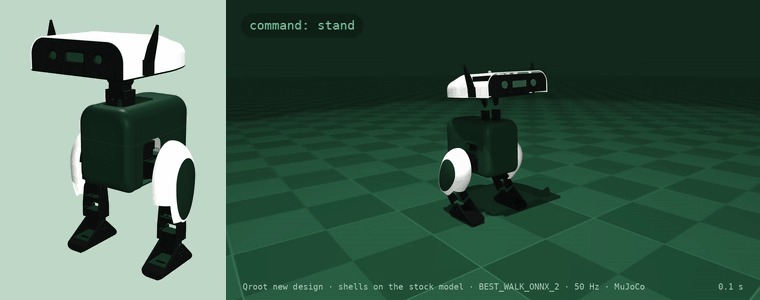
  </a>
</p>
<p align="center">
  <sub>The new design, and the same design walking in MuJoCo at 50 Hz: stand, walk, turn, sidestep, take a 0.5 m/s sideways push, stop.
  Sped up 1.5×. Click for the <a href="docs/media/qroot_walk.mp4">full video</a>.</sub>
</p>

## Why a full stack

Digital AI is one layer: software. Physical AI is seven, and each one is a different skill: the AI model,
perception, simulation, real-time control, compute, actuation and mechanics. They all have to work in the same
instant. Qroot builds all seven on one small robot and opens every one of them.

<p align="center">
  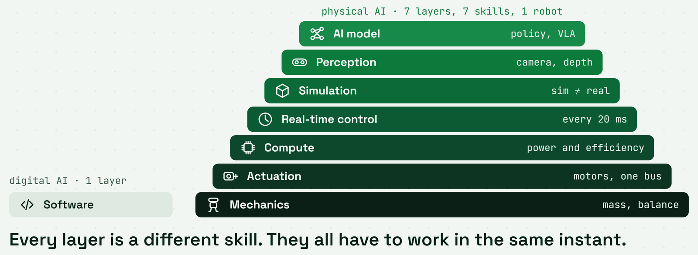
</p>

## Six layers, each one replaceable

| Layer | In Qroot today | Designed to swap with |
|---|---|---|
| Train | MuJoCo MJX + Brax PPO, exported to ONNX | any simulator that exports ONNX |
| Deploy | walking policy on the CPU, speech on the NPU through [Chipwright](https://github.com/nameissakthi25/chipwright) | other chips as Chipwright adds targets |
| Compute | Qualcomm RB3 Gen 2 (QCS6490) | other chipsets, in progress |
| Actuation | Feetech STS bus servos + a custom Pico bridge | other serial-bus servos |
| Perception | Intel RealSense D455 | OAK-D Lite, other depth cameras |
| Body | micro biped, 14 joints | arm, quadruped, base with an arm |

## Meet Qroot

Qroot is the first robot on the stack.

<p align="center">
  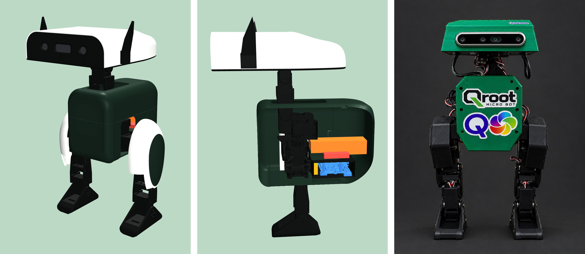
</p>
<p align="center">
  <sub><b>New design</b> &nbsp;·&nbsp; <b>New design, inside:</b> battery (orange), RB3 Gen 2 (blue), Pico bridge (yellow) &nbsp;·&nbsp; <b>First build</b></sub>
</p>

- **Depth camera:** a RealSense D455 is the head.
- **One board, carried:** a Qualcomm RB3 Gen 2 inside the body.
- **14 bus servos:** Feetech STS3215, on one bus.
- **Speech:** recognition and text-to-speech on the board.

The code, the Python package (`jero_link`) and the paths on the robot (`~/Jero`, `~/.config/jero`) still use the
robot's earlier name, Jero.

## Every model runs on the robot

| Model | Where | Detail |
|---|---|---|
| Walking policy | CPU, under 0.5 ms | ONNX, 101 inputs, 14 joint targets, 50 times a second. Small enough that the CPU is the right place for it. |
| Speech recognition and text-to-speech | Hexagon NPU | Quantised and converted with [Chipwright](https://github.com/nameissakthi25/chipwright). Detection is next. |

<p align="center">
  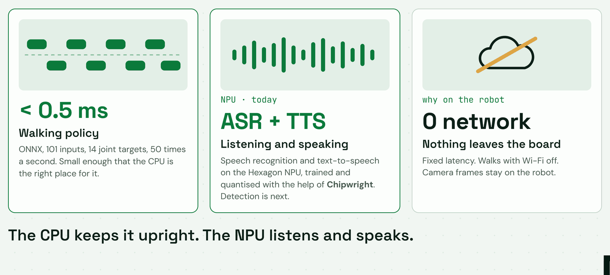
</p>

Nothing leaves the board. Latency is fixed, the robot walks with Wi-Fi off, and camera frames stay on the robot.

### Getting models onto the NPU: Chipwright

[Chipwright](https://github.com/nameissakthi25/chipwright) (open source, MIT) takes a model to the edge board in three
steps: bring your model, connect your board, and it handles QAIRT conversion, AIMET quantisation and the serialised
binaries. Qualcomm is first, with more chipsets planned. It has a desktop app and skills for coding agents.

<p align="center">
  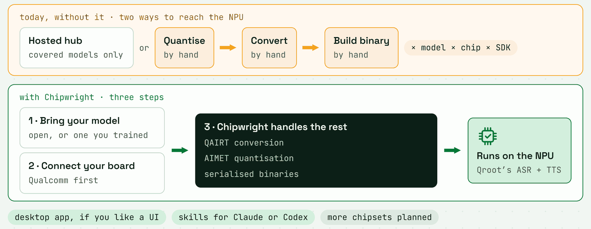
</p>

## Inside one 20 ms tick

The walk loop is one process on the fastest core at real-time priority (`robot/jero_walk.py`). Measured on the
RB3 Gen 2: 3.8 ms servo bus read and 0.75 ms compute in a 20 ms budget, with no missed ticks.

<p align="center">
  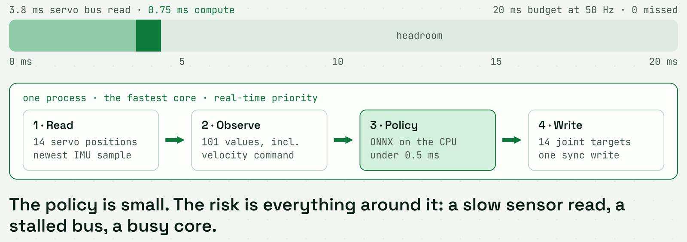
</p>

Nothing that can block goes inside the loop:
- **Servo bus:** the Pico bridge answers every transaction once, with all the replies or one error marker. A lost
  reply costs one 20 ms step, not a 1 s USB timeout.
- **IMU:** the board's ICM-42688 is streamed through Qualcomm's sensing hub (`robot/imu_qsh.py`). The loop takes
  the newest sample in 0.05 ms. Reading sysfs files inside the tick took 14 ms.

<p align="center">
  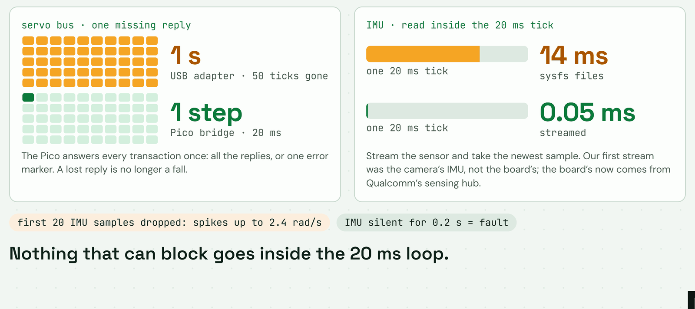
</p>

## ROS 2 is where the parts swap

**Status: designed, the bridge is not built yet.** Today the robot is driven by a gamepad or by `jero_link`
(signed UDP).

The 20 ms policy loop stays outside the ROS 2 graph: read, policy, write, in one process on one core, with no DDS
or executor. One thin bridge node translates to standard interfaces and never sits between the policy and the
servos.

<p align="center">
  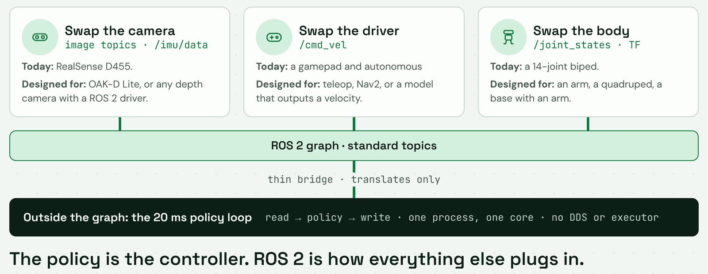
</p>

| On the robot | ROS 2 interface | What you get |
|---|---|---|
| Signed UDP velocity command, 20 Hz | `/cmd_vel` (Twist) | `teleop_twist_keyboard`, Nav2 |
| Gamepad always beats the link | `twist_mux` priorities + e-stop lock | one place for "who drives" |
| Commands expire after 500 ms | `twist_mux` timeout | silence means stop |
| 14 servo positions each tick | `/joint_states` | `robot_state_publisher`, RViz |
| IMU sample each tick | `/imu/data` | rosbag, filters, plots |
| RealSense D455 on USB | `realsense2_camera` | depth, point clouds, TF |

Navigation follows the same path: the depth camera sees, a point cloud and TF make the map, Nav2 plans, and
`/cmd_vel` goes to the policy.

<p align="center">
  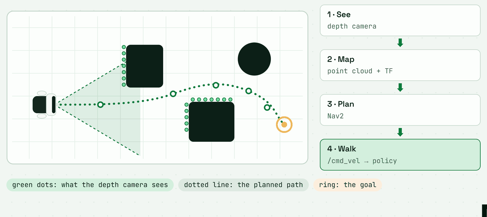
</p>

## One stack, other bodies

The body changes. The recipe stays: train in MuJoCo, export ONNX, one real-time loop, the servo bus bridge, and
ROS 2 at the edges.

<p align="center">
  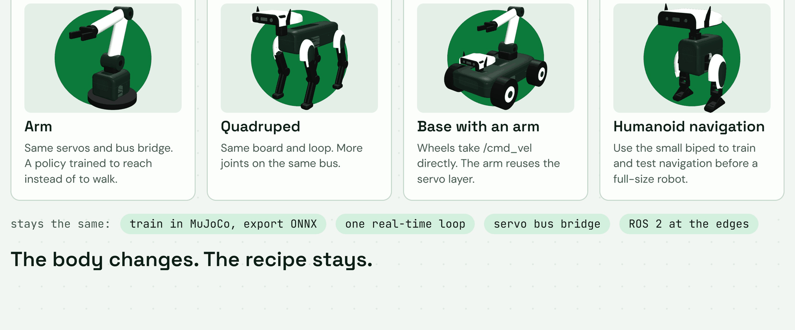
</p>

## Branches

| Branch | Robot computer | State |
|---|---|---|
| `main` | Qualcomm RB3 Gen 2 | **Qroot**, active |
| `pi-zero` | Raspberry Pi Zero 2 W | frozen demo build of the Pi version (`robot/demo.sh`) |

## Run it

The steps in order are in [docs/commands/](docs/commands/README.md):
1. Pose.
2. Check the servos.
3. Check the camera.
4. Open the dashboard.
5. Walk without the pad.
6. Walk with the pad.
7. Stand still.

Setup and bring-up details are in [docs/rb3gen2.md](docs/rb3gen2.md).

```bash
git clone https://github.com/roboticsbydev/Qroot ~/Jero
~/Jero/robot/setup_rb3.sh            # packages, Python env, runtime, policy, link key, Bluetooth, udev
~/Jero/robot/setup_vision.sh         # RealSense + OpenCV
~/Jero/tools/rb3_dryrun.sh           # whole-robot check, nothing moves
~/Jero/robot/jero.sh                 # walk with the PS4 pad (Cross starts/pauses)
```

**E-stop from a terminal on the robot:** `python ~/Jero/tools/estop.py 127.0.0.1`

## Repo layout

```
docs/          RB3 bring-up, command sheets, BOM, printing, wiring, training, link spec, demo day
robot/         walk loop (policy + controller mux), servo IO, IMU drivers, setup scripts
brain/         dashboard (eyes), show controller, voice, expressions, teleop, follow-me
jero_link/     pip package: UDP + HMAC command protocol, client and receiver
training/      GPU server: set up, train, watch in MuJoCo, deploy a policy
tools/         pose, bus and IMU tests, dry run, e-stop, pad test, servo configuration
cad_parts/     printable parts for the new design: D455 head, leg pods, trunk top, 6002Z bearing parts
upstream/      pinned git submodules (read-only)
tests/         hardware-free tests
```

## Development machines

**Laptop**
```bash
git clone --recurse-submodules --shallow-submodules https://github.com/roboticsbydev/Qroot && cd Qroot
pip install -e jero_link[test] numpy && make test
```

**GPU server (training)**
```bash
git clone --recurse-submodules=upstream/Open_Duck_Playground --shallow-submodules https://github.com/roboticsbydev/Qroot
Qroot/training/setup_server.sh && Qroot/training/train.sh
```
